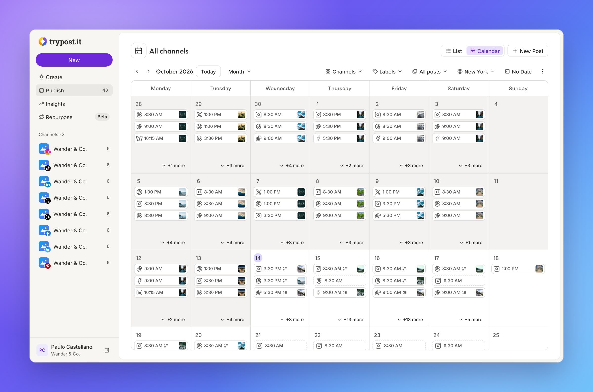
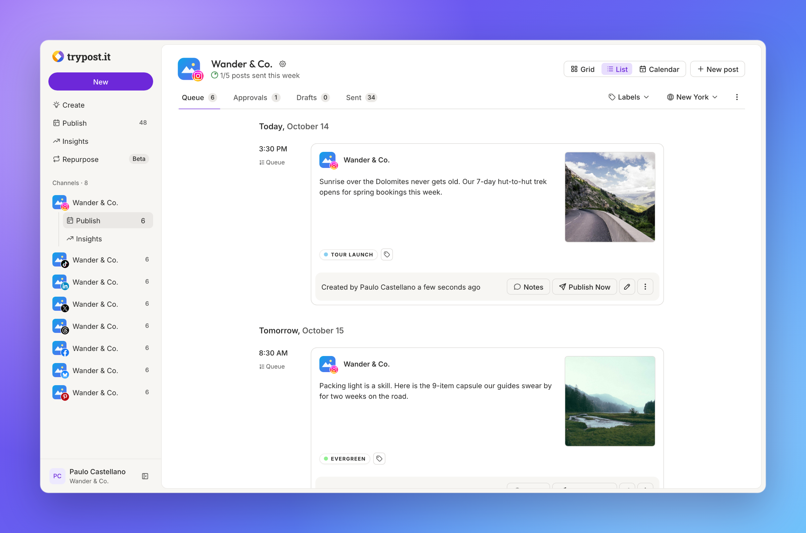
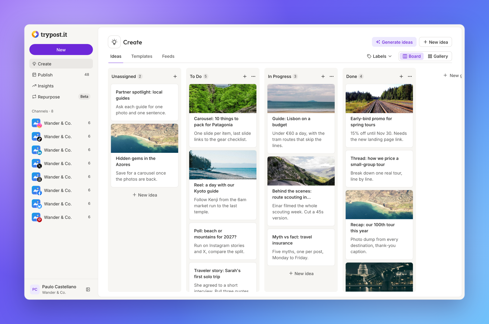
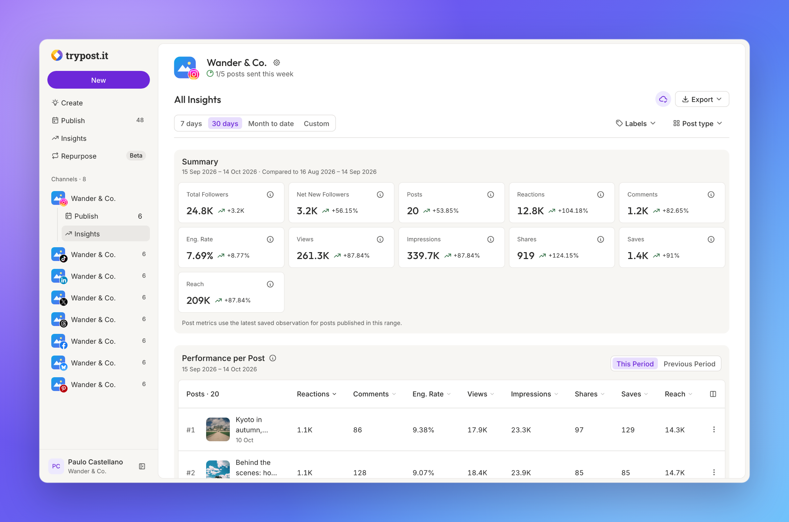

  

<h1 align="center">The open-source social media scheduler built for AI agents</h1>

  Let your AI agents create, schedule and publish posts to every network through MCP or the REST API, 
  or write them yourself in a composer your team will love.

  
  
  
  

  <a href="https://trypost.it"><b>Try TryPost Cloud</b></a> &nbsp;&bull;&nbsp;
  <a href="https://docs.trypost.it">Documentation</a> &nbsp;&bull;&nbsp;
  <a href="https://trypost.it/discord">Discord</a> &nbsp;&bull;&nbsp;
  <a href="https://github.com/trypostit/trypost/discussions">Community</a>

  

---

## Two ways to post, one place to run it

Most posts on TryPost are no longer written by hand. They come from AI agents and scripts. The rest come from teams who still want a great editor, a calendar and someone to approve before anything goes live. TryPost is built for both.

### 🤖 For AI agents: MCP and REST API

Connect Claude, ChatGPT, Cursor or any MCP client and ask in plain words:

> *"Write a week of posts about our spring tours for Instagram, LinkedIn and X, add them to each channel's queue and show me the Instagram insights for last month."*

- **MCP server** with 80+ tools: posts, media, queues, ideas, labels, signatures, analytics and more. [Connect your assistant &rarr;](https://docs.trypost.it/ai/introduction)
- **REST API** for your own scripts and automations: create posts in batch, upload media, read metrics, receive webhooks. [API reference &rarr;](https://docs.trypost.it/api-reference/introduction)
- Everything the app can do, your agent can do. Same rules, same limits, same approvals.

### ✍️ For teams: the web app

- **Composer** that writes once and adapts per network, with a live preview of every post and an AI assistant to rephrase, shorten or expand.
- **Calendar and queues**: drop posts on each channel's posting times, drag to reschedule, see the whole month at a glance.
- **Approvals**: members who need a review send posts for approval, and admins approve or reject in one click. Built for agencies running many brands.
- **Workspaces** to keep every client or brand apart, with its own channels, members and settings.

## A closer look

  
   <b>Queues.</b> Set each channel's posting times once. New posts take the next free slot.

  
   <b>Ideas board.</b> Collect ideas, move them through your stages and turn them into posts.

  
   <b>Insights.</b> Followers, reach and engagement per channel and per post, compared with the previous period.

## Supported networks

Every post is published natively through each network's official API. No reminders, no "finish in the mobile app".

<table>
  <tr>
    <td align="center"> <b>Instagram</b></td>
    <td align="center"> <b>TikTok</b></td>
    <td align="center"> <b>LinkedIn</b></td>
    <td align="center"> <b>X</b></td>
    <td align="center"> <b>YouTube</b></td>
    <td align="center"> <b>Facebook</b></td>
    <td align="center"> <b>Threads</b></td>
  </tr>
  <tr>
    <td align="center"> <b>Bluesky</b></td>
    <td align="center"> <b>Pinterest</b></td>
    <td align="center"> <b>Mastodon</b></td>
    <td align="center"> <b>Google Business</b></td>
    <td align="center"> <b>Telegram</b></td>
    <td align="center"> <b>Discord</b></td>
    <td></td>
  </tr>
</table>

## Everything else you get

|  |  |
| --- | --- |
| **Repurpose** | Videos you post outside TryPost are copied to your other networks automatically. |
| **Media sources** | Upload from your device, Unsplash, Google Drive, Google Photos and Canva. |
| **Signatures and labels** | Reusable hashtag and CTA blocks, color-coded labels to filter the calendar. |
| **Notes** | Leave feedback on a post and the rest of the team gets an email. |
| **Webhooks** | Get notified when a post is created, scheduled, published, fails or is deleted. |
| **16 languages** | English, Portuguese, Spanish, French, German, Italian, Dutch, Polish, Greek, Ukrainian, Russian, Turkish, Arabic, Japanese, Korean and Chinese. |

## Open source, with every feature

TryPost is open source under AGPL-3.0. You can self-host it on your own servers and keep your posts, drafts and metrics on your infrastructure. The self-hosted version has every feature of TryPost Cloud: no paid tiers, no locked features.

If you would rather not run servers, [TryPost Cloud](https://trypost.it) is the same product, hosted and updated for you.

## Built by Paulo Castellano

Hi, I'm Paulo, and I build TryPost in the open. Follow me for what is coming next to TryPost.

  
  

## Community and contributing

- **Questions or ideas?** Join the [Discord](https://trypost.it/discord) or open a [Discussion](https://github.com/trypostit/trypost/discussions).
- **Found a bug?** Open an [issue](https://github.com/trypostit/trypost/issues).
- **Want to help?** Pull requests of any size are welcome.

Short on time? A ⭐ is the best way to help. It puts TryPost in front of more people.

## License

[GNU Affero General Public License v3.0](LICENSE.md). Use, modify, fork, self-host and redistribute, including commercially. If you run a modified version as a network service, make your changes available to its users (AGPL §13).
